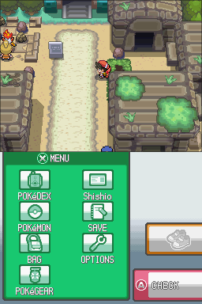
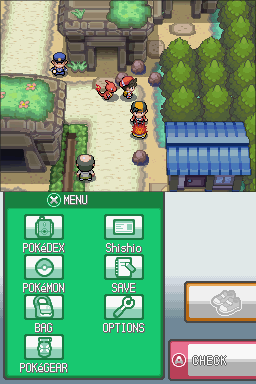
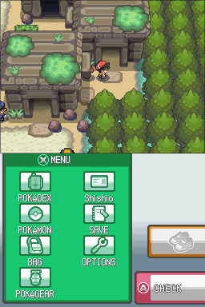
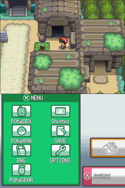

# Ruins of Alph: blocked grass and Silver's door

**Can't get past the grass or enter the door where Silver is waiting?** The green patch beside the north-east ruin is solid scenery. You can't walk through it. Go around the large ruin immediately south of the doorway and approach from the east (right).

1. **Start at the blocked green patch.** Step left onto the main path, then head south (down). Keep left of the person beside the large ruin.

   

2. **Go around the bottom of the large ruin.** Turn east (right) below it, toward the path beside the trees.

   

3. **Follow the eastern path north (up).** Continue around the right side of the ruins toward the narrow passage.

   

4. **Turn west (left) toward the door, then walk north into it.** This is the Kabuto-puzzle chamber where you meet Silver.

   

**Silver isn't inside?** Speak to the Research Center assistant, then ask **both Gold and Crystal about Molly**, answering Yes to each. See [the missing Molly story steps](08-cherrygrove-to-azalea.md#ruins-of-alph-the-missing-molly-story-chapter-how-to-move-it-along).

The blocked shortcut is also present in the original Chinese hack. The route above was walked successfully in the English version.

*Source:* Map 113 collision and event data compared between untouched CN v4.0.3 and the local English build; actual walking reached map 312 through the door at (436,266). Investigation and screenshot provenance: work/notes/alph_kabuto_door_report_20261010.md; emulator captures 2026-10-10. Screenshots show the walking route; NPCs may differ with story progress.
