# Hidden items

[← Guide index](README.md)

Every hidden item the game data places on a map: 204 spots, plus 6 where we have no screenshot yet. Hidden items are not shown on the map. Stand on the tile next to the spot, face it and press A: the text box appears and the item goes into your Bag. Each picture below is taken at that moment, with the player standing where A works. The player's name in the text box is the test save's; yours will show instead.

How the pictures were made: the English patch (v1.0.0-rc7) was run in an emulator at midday, with an empty Bag, and the player was placed next to each spot with the game's own warp. Directions are counted in steps from the nearest door on the same map; if no door is near, only the picture shows the place. Spots are grouped by map, Kanto first, then Johto and the caves. Items marked **Missing screenshot** could not be photographed; the reason is given under each.

Some spots are listed twice by the game (the same tile belongs to two neighbouring maps, or to the Indigo Conference stage maps); they appear once here.

## Missing screenshots

- Celadon City: PP Up
- Mt. Silver, hot-spring mountainside: Hyper Potion
- Mt. Silver Cave: Revive
- Mt. Silver Cave Upper Mountainside: Hyper Potion
- Route 40: Hyper Potion
- Frontier Access: Rare Candy

## Pewter City

**Big Mushroom**: 4 steps north and 2 steps west of the door to Pewter Northeast house.

Stand on the tile just south of the spot, facing north, and press A.

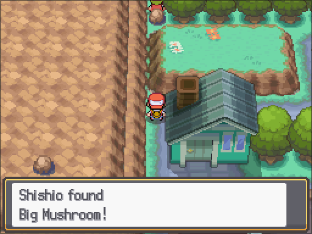

*Source:* hidden-item event 8194, zone 51.

**PP Up**

Stand on the tile just north of the spot, facing south, and press A.

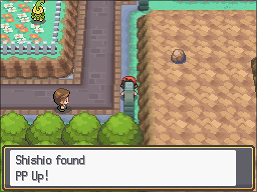

*Source:* hidden-item event 8198, zone 51.

**Nugget**: 8 steps south and 1 step east of the door to Pewter Northeast house.

Stand on the tile just south of the spot, facing north, and press A.

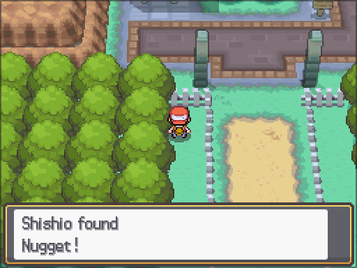

*Source:* hidden-item event 8200, zone 51.

## Route 3

**Ultra Ball**

Stand on the tile just south of the spot, facing north, and press A.

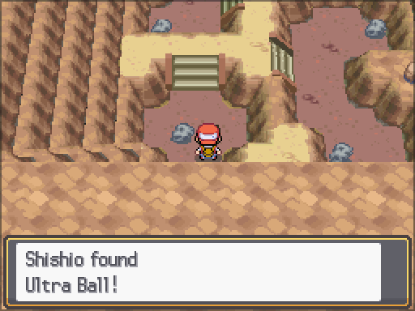

*Source:* hidden-item event 8113, zone 11.

## Mt. Moon

**Revive**

Stand on the tile just south of the spot, facing north, and press A.

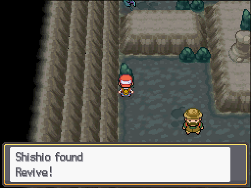

*Source:* hidden-item event 8195, zone 107.

## Mt. Moon Square

**Max Revive**: 3 steps north and 7 steps west of the door to Mt. Moon, east building.

Stand on the tile just south of the spot, facing north, and press A.

**Note:** a character stands on this spot at first, so A talks to them. The screenshot was taken with that character removed; when in the story this happens was not checked.

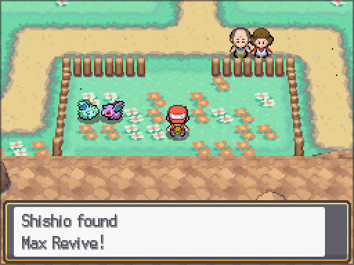

*Source:* hidden-item event 8196, zone 449; blocking NPC hide flag(s) 1993.

## Mt. Moon Square (Clefairy dance night)

**Max Revive**: 6 steps north and 8 steps east of the door to Mt. Moon Square Entrance.

Stand on the tile just south of the spot, facing north, and press A.

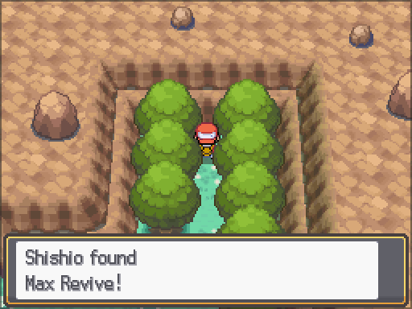

*Source:* hidden-item event 8196, zone 513.

## Route 4

**Star Piece**: 4 steps north and 9 steps east of the door to Mt. Moon, east building.

Stand on the tile just south of the spot, facing north, and press A.

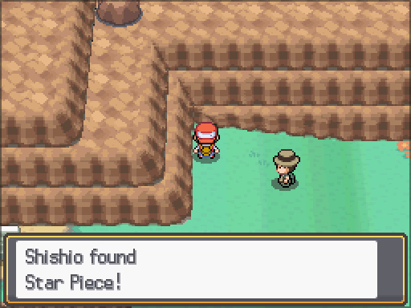

*Source:* hidden-item event 8145, zone 12.

**Star Piece**

Stand on the tile just west of the spot, facing east, and press A.

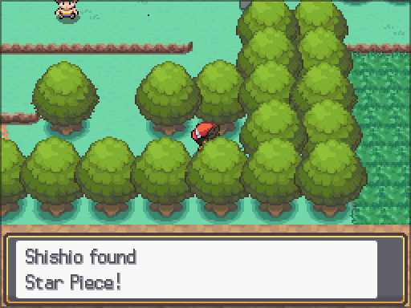

*Source:* hidden-item event 8138, zone 12.

## Cerulean City

**Nugget**

Stand on the tile just north of the spot, facing south, and press A.

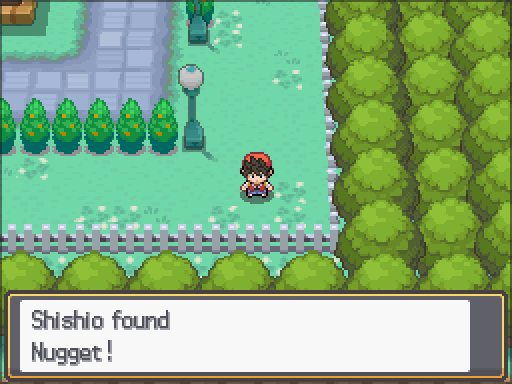

*Source:* hidden-item event 8106, zone 52.

## Route 25

**Revive**

Stand on the tile just south of the spot, facing north, and press A.

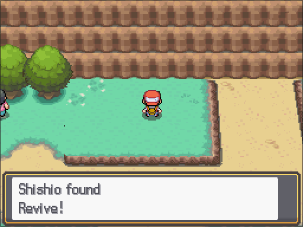

*Source:* hidden-item event 8107, zone 29.

## Route 5 Underground Path

**Full Restore**: 9 steps south and 1 step east of the door to Route 5, Underground Path gatehouse.

Stand on the tile just south of the spot, facing north, and press A.

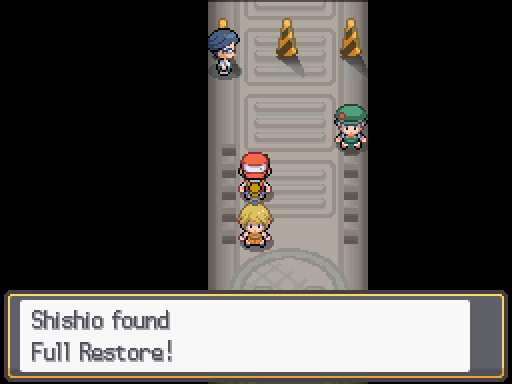

*Source:* hidden-item event 8057, zone 532.

**X Sp. Atk**

Stand on the tile just south of the spot, facing north, and press A.

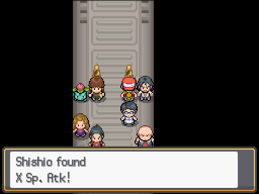

*Source:* hidden-item event 8058, zone 532.

## Vermilion City

**Full Heal**: 3 steps north and 14 steps east of the door to Vermilion Poké Mart.

Stand on the tile just north of the spot, facing south, and press A.

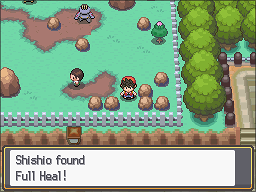

*Source:* hidden-item event 8103, zone 54.

**Heart Scale**: 5 steps south and 8 steps east of the door to Vermilion Central house.

Stand on the tile just south of the spot, facing north, and press A.

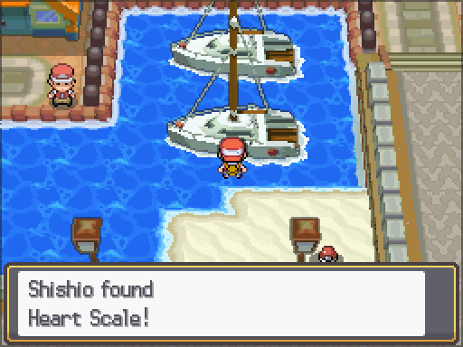

*Source:* hidden-item event 8168, zone 54.

**Pearl**: 5 steps north and 4 steps east of the door to Vermilion Harbor.

Stand on the tile just south of the spot, facing north, and press A.

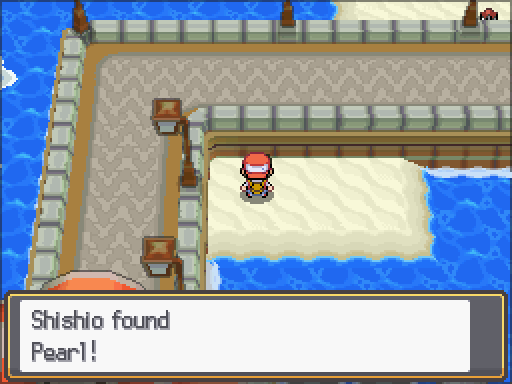

*Source:* hidden-item event 8163, zone 54.

**Big Pearl**: 5 steps north and 6 steps east of the door to Vermilion Harbor.

Stand on the tile just south of the spot, facing north, and press A.

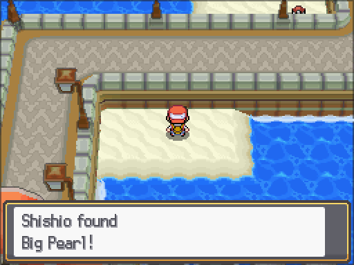

*Source:* hidden-item event 8164, zone 54.

**Pearl**: 4 steps north and 3 steps east of the door to Vermilion Harbor.

Stand on the tile just south of the spot, facing north, and press A.

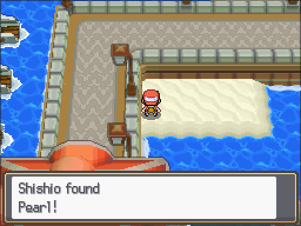

*Source:* hidden-item event 8162, zone 54.

## Vermilion Harbor pier

**Iron**: 3 steps south and 3 steps east of the door to S.S. Anne.

Stand on the tile just south of the spot, facing north, and press A.

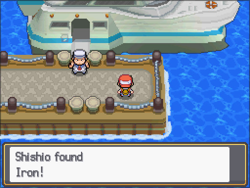

*Source:* hidden-item event 8084, zone 387.

## Diglett’s Cave

**Max Revive**: 6 steps south and 7 steps west of the door to Diglett’s Cave.

Stand on the tile just south of the spot, facing north, and press A.

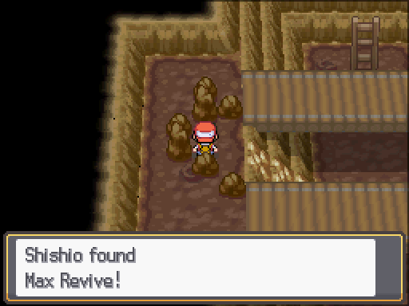

*Source:* hidden-item event 8056, zone 106.

## Route 11

**Revive**

Stand on the tile just south of the spot, facing north, and press A.

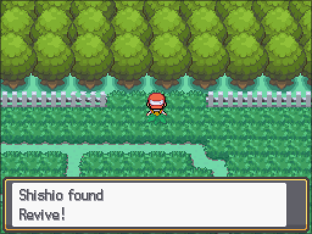

*Source:* hidden-item event 8104, zone 19.

## Route 10

**Carbos**: 1 step north and 5 steps west of the door to Power Plant.

Stand on the tile just south of the spot, facing north, and press A.

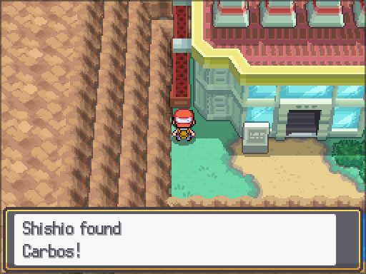

*Source:* hidden-item event 8197, zone 18.

## Route 10 South

**PP Up**: 11 steps south of the door to Rock Tunnel.

Stand on the tile just south of the spot, facing north, and press A.

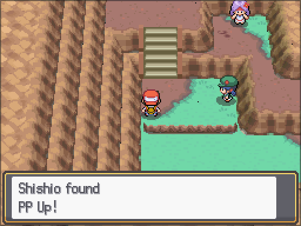

*Source:* hidden-item event 8198, zone 388.

## Rock Tunnel

**Ultra Ball**: 3 steps north and 2 steps west of the door to Rock Tunnel.

Stand on the tile just north of the spot, facing south, and press A.

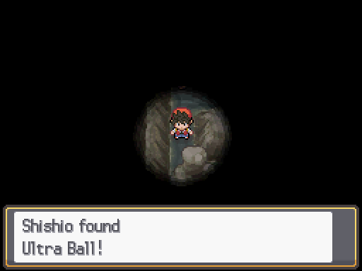

*Source:* hidden-item event 8226, zone 342.

## Rock Tunnel B1F

**HP Up**: 17 steps east of the door to Alto Mare Waters.

Stand on the tile just south of the spot, facing north, and press A.

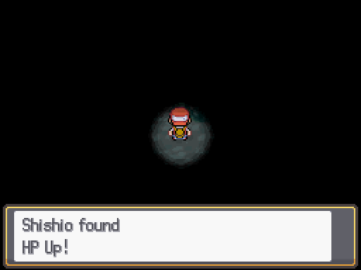

*Source:* hidden-item event 8169, zone 452.

**Max Potion**: 16 steps south and 1 step east of the door to Alto Mare Waters.

Stand on the tile just south of the spot, facing north, and press A.

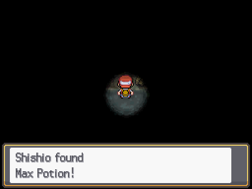

*Source:* hidden-item event 8061, zone 452.

## Celadon City

**PP Up**: 11 steps south and 5 steps east of the door to Celadon Restaurant.

**Missing screenshot.** The spot lies in a part of the map that doesn't draw (black screen), so it couldn't be reached or photographed.

*Source:* hidden-item event 8122, zone 55.

## Route 17

**Max Ether**

Stand on the tile just south of the spot, facing north, and press A.

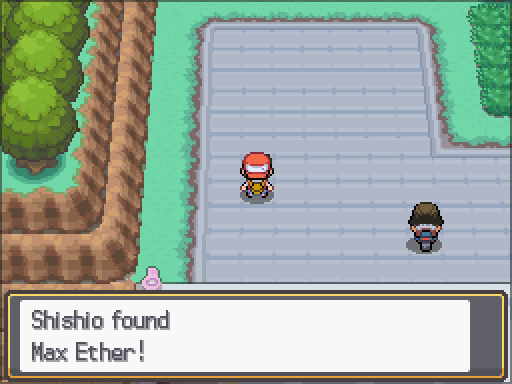

*Source:* hidden-item event 8109, zone 25.

**Max Elixir**

Stand on the tile just south of the spot, facing north, and press A.

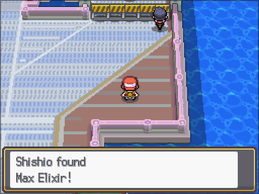

*Source:* hidden-item event 8110, zone 25.

## Fuchsia City

**Nugget**: 6 steps south and 3 steps east of the door to Fuchsia Southwest house.

Stand on the tile just south of the spot, facing north, and press A.

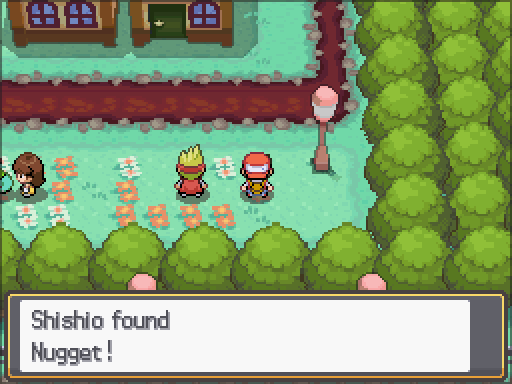

*Source:* hidden-item event 8134, zone 56.

## Resort Zone

**Tiny Mushroom**: 3 steps north and 7 steps east of the door to Resort Zone Pokémon Center.

Stand on the tile just north of the spot, facing south, and press A.

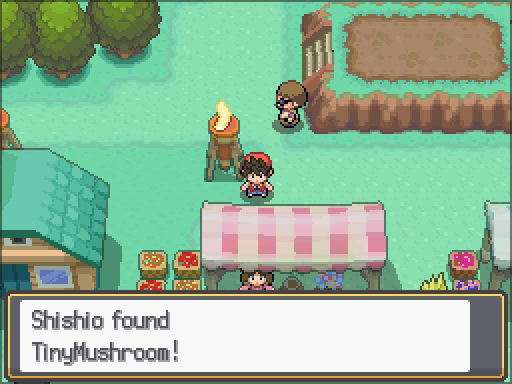

*Source:* hidden-item event 8131, zone 174.

**Tiny Mushroom**: 2 steps north and 4 steps east of the door to Resort Zone Pokémon Center.

Stand on the tile just south of the spot, facing north, and press A.

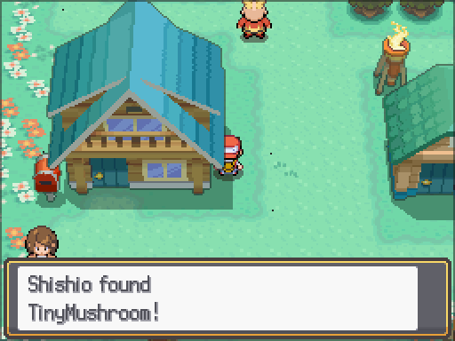

*Source:* hidden-item event 8130, zone 174.

**Tiny Mushroom**: 3 steps south and 4 steps west of the door to Resort Zone Pokémon Center.

Stand on the tile just south of the spot, facing north, and press A.

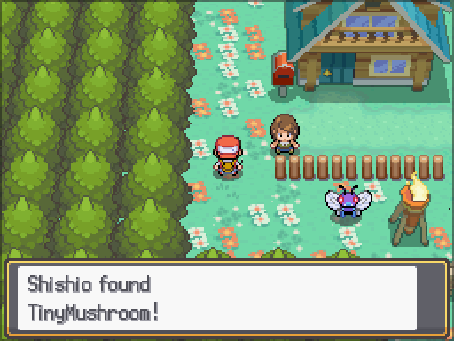

*Source:* hidden-item event 8041, zone 174.

## Route 12

**Elixir**: 3 steps north and 7 steps east of the door to Route 11 gatehouse.

Stand on the tile just east of the spot, facing west, and press A.

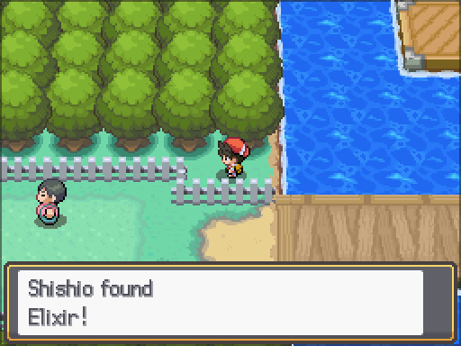

*Source:* hidden-item event 8112, zone 20.

## Route 13

**Calcium**

Stand on the tile just east of the spot, facing west, and press A.

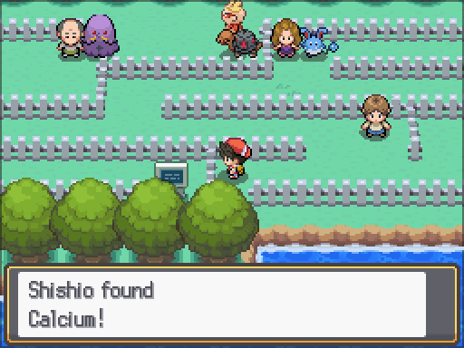

*Source:* hidden-item event 8111, zone 21.

## Route 19

**Revive**: 3 steps south and 6 steps east of the door to Route 19 gatehouse.

Stand on the tile just south of the spot, facing north, and press A.

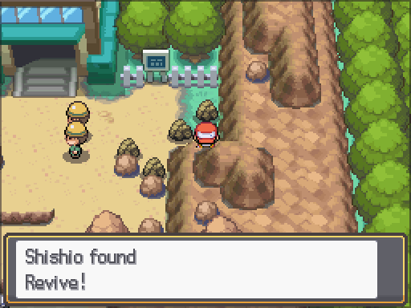

*Source:* hidden-item event 8207, zone 91.

**Max Elixir**: 7 steps south and 5 steps east of the door to Route 19 gatehouse.

Stand on the tile just south of the spot, facing north, and press A.

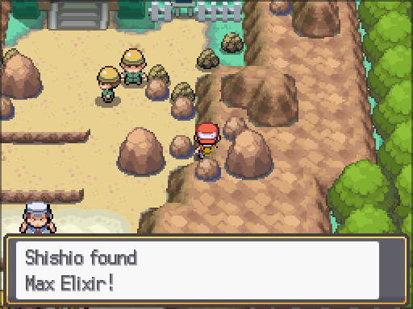

*Source:* hidden-item event 8208, zone 91.

**Pearl**: 14 steps south and 3 steps east of the door to Route 19 gatehouse.

Stand on the tile just south of the spot, facing north, and press A.

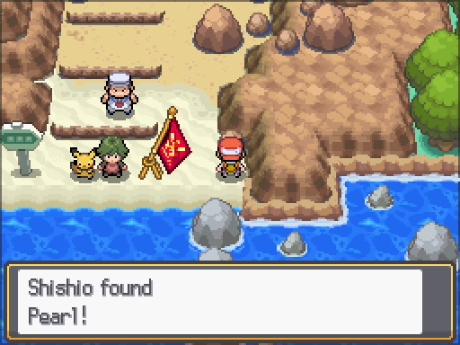

*Source:* hidden-item event 8178, zone 91.

**Pearl**: 15 steps south and 5 steps west of the door to Route 19 gatehouse.

Stand on the tile just south of the spot, facing north, and press A.

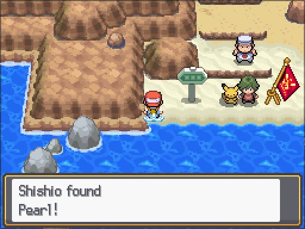

*Source:* hidden-item event 8179, zone 91.

**Big Pearl**

Stand on the tile just south of the spot, facing north, and press A.

**Note:** a character stands on this spot at first, so A talks to them. The screenshot was taken with that character removed; when in the story this happens was not checked.

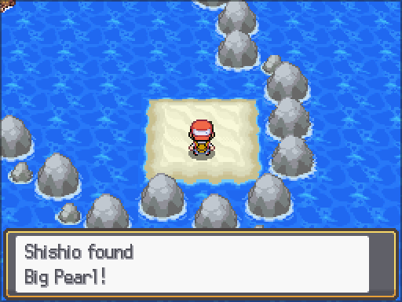

*Source:* hidden-item event 8180, zone 91; blocking NPC hide flag(s) 1211,1212.

## Route 20

**Deep Sea Tooth**: 10 steps north and 6 steps west of the door to Seafoam Islands.

Stand on the tile just south of the spot, facing north, and press A.

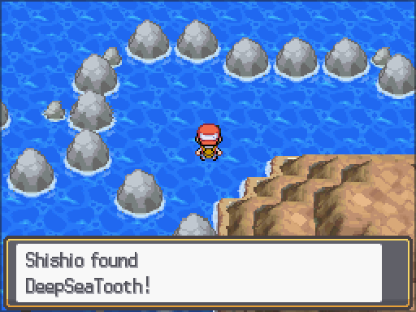

*Source:* hidden-item event 8038, zone 92.

**Stardust**: 3 steps south and 19 steps west of the door to Seafoam Islands.

Stand on the tile just south of the spot, facing north, and press A.

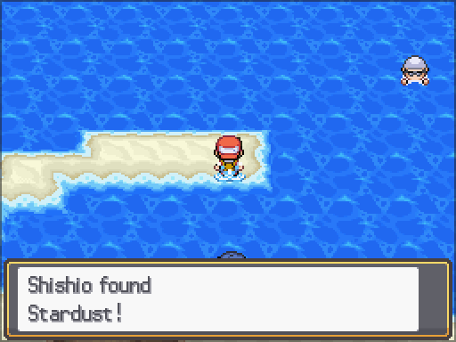

*Source:* hidden-item event 8174, zone 92.

## Seafoam Islands

**Escape Rope**: 1 step north and 4 steps east of the door to Seafoam Islands B1F.

Stand on the tile just south of the spot, facing north, and press A.

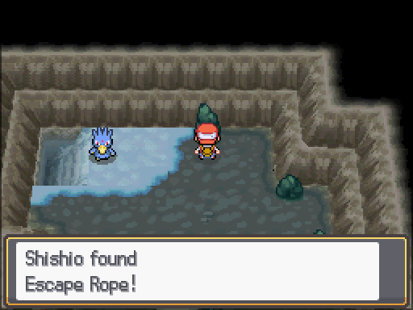

*Source:* hidden-item event 8088, zone 146.

## Seafoam Islands B1F

**Ice Heal**: 3 steps north and 3 steps west of the door to Seafoam Islands B2F.

Stand on the tile just north of the spot, facing south, and press A.

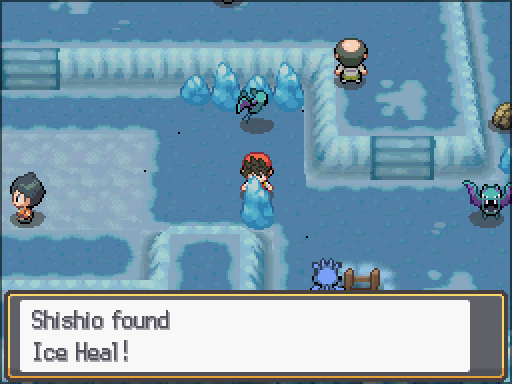

*Source:* hidden-item event 8089, zone 453.

## Seafoam Islands B2F

**Pearl**: 17 steps north of the door to Seafoam Islands B3F.

Stand on the tile just south of the spot, facing north, and press A.

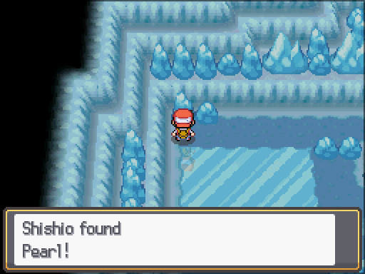

*Source:* hidden-item event 8090, zone 454.

**Pearl**: 5 steps north of the door to Seafoam Islands B3F.

Stand on the tile just south of the spot, facing north, and press A.

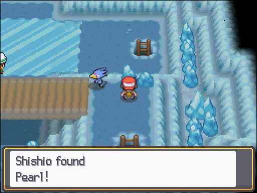

*Source:* hidden-item event 8091, zone 454.

## Seafoam Islands B3F

**Max Revive**: 4 steps south and 1 step east of the door to Seafoam Islands B4F.

Stand on the tile just north of the spot, facing south, and press A.

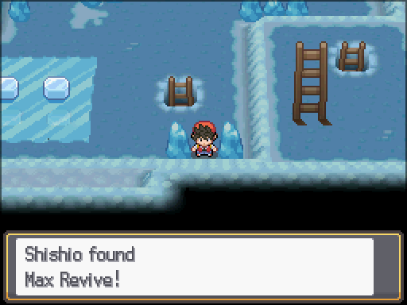

*Source:* hidden-item event 8092, zone 455.

## Seafoam Islands B4F

**Zinc**: 4 steps west of the door to Seafoam Islands, inner room.

Stand on the tile just south of the spot, facing north, and press A.

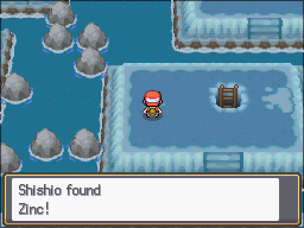

*Source:* hidden-item event 8223, zone 456.

## Route 21

**Stardust**

Stand on the tile just south of the spot, facing north, and press A.

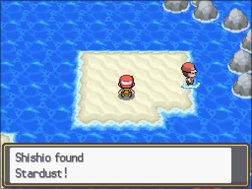

*Source:* hidden-item event 8175, zone 93.

**Stardust**

Stand on the tile just south of the spot, facing north, and press A.

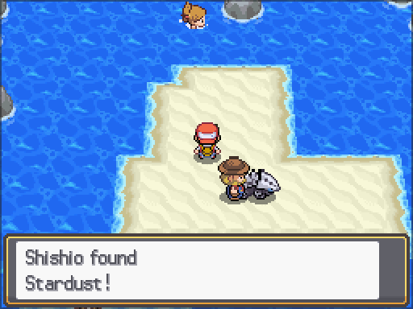

*Source:* hidden-item event 8176, zone 93.

**Stardust**

Stand on the tile just south of the spot, facing north, and press A.

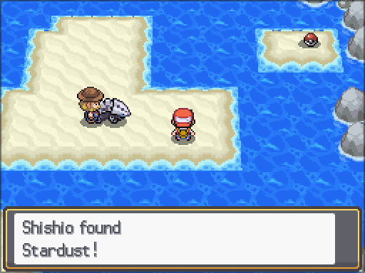

*Source:* hidden-item event 8177, zone 93.

**Rare Candy**

Stand on the tile just south of the spot, facing north, and press A.

*Source:* hidden-item event 8114, zone 93.

## Cinnabar Island

**Iron**: 9 steps east of the door to Cinnabar Island, north house.

Stand on the tile just east of the spot, facing west, and press A.

*Source:* hidden-item event 8166, zone 57.

**Rare Candy**: 1 step north and 3 steps east of the door to Cinnabar Island, central building.

Stand on the tile just north of the spot, facing south, and press A.

*Source:* hidden-item event 8114, zone 57.

**Star Piece**: 2 steps south and 1 step west of the door to Cinnabar Island Pokémon Center.

Stand on the tile just south of the spot, facing north, and press A.

*Source:* hidden-item event 8167, zone 57.

## Victory Road

**Full Heal**: 3 steps east of the door to Victory Road 2F.

Stand on the tile just west of the spot, facing east, and press A.

*Source:* hidden-item event 8080, zone 124.

**Max Potion**

Stand on the tile just south of the spot, facing north, and press A.

*Source:* hidden-item event 8079, zone 124.

## Victory Road 2F

**Max Revive**: 4 steps north and 8 steps east of the door to Victory Road.

Stand on the tile just west of the spot, facing east, and press A.

*Source:* hidden-item event 8185, zone 178.

**PP Up**: 6 steps north and 1 step east of the door to Victory Road 3F.

Stand on the tile just south of the spot, facing north, and press A.

*Source:* hidden-item event 8186, zone 178.

**Ultra Ball**: 3 steps south and 6 steps east of the door to Victory Road 3F.

Stand on the tile just south of the spot, facing north, and press A.

*Source:* hidden-item event 8189, zone 178.

## Victory Road 3F

**Hyper Potion**: 4 steps south and 5 steps east of the door to Indigo Plateau (Indigo Conference: finalists' arrival).

Stand on the tile just south of the spot, facing north, and press A.

*Source:* hidden-item event 8139, zone 179.

**Hyper Potion**: 1 step south and 10 steps east of the door to Victory Road 2F.

Stand on the tile just south of the spot, facing north, and press A.

*Source:* hidden-item event 8187, zone 179.

## Indigo Plateau

**Rare Candy**: 3 steps south and 8 steps east of the door to Pokémon League Entrance.

Stand on the tile just south of the spot, facing north, and press A.

This is the same spot that Indigo Plateau (Indigo Conference stage two) also lists.

*Source:* hidden-item event 8190, zone 58.

## Indigo Plateau (Indigo Conference stage one)

**Rare Candy**

Stand on the tile just south of the spot, facing north, and press A.

*Source:* hidden-item event 8190, zone 195.

## Route 26

**Tiny Mushroom**

Stand on the tile just south of the spot, facing north, and press A.

*Source:* hidden-item event 8184, zone 30.

**Nugget**

Stand on the tile just south of the spot, facing north, and press A.

This is the same spot that Route 27 also lists.

*Source:* hidden-item event 8183, zone 30.

## Route 27

**Revive**

Stand on the tile just west of the spot, facing east, and press A.

*Source:* hidden-item event 8181, zone 31.

**Big Mushroom**

Stand on the tile just south of the spot, facing north, and press A.

*Source:* hidden-item event 8182, zone 31.

## Route 28

**Rare Candy**: 4 steps north and 13 steps west of the door to Route 26 gatehouse.

Stand on the tile just west of the spot, facing east, and press A.

*Source:* hidden-item event 8115, zone 32.

**Full Restore**: 24 steps west of the door to Route 28 House.

Stand on the tile just south of the spot, facing north, and press A.

*Source:* hidden-item event 8116, zone 32.

## Mt. Silver, hot-spring mountainside

**Max Ether**: 1 step west of the door to Mt. Silver Cave 2F.

Stand on the tile just east of the spot, facing west, and press A.

*Source:* hidden-item event 8204, zone 65.

**Hyper Potion**: 1 step south and 6 steps east of the door to Mt. Silver Cave 3F.

**Missing screenshot.** The spot is inside solid rock with no tile next to it to stand on.

*Source:* hidden-item event 8205, zone 65.

**Rare Candy**: 2 steps north and 11 steps west of the door to Mt. Silver Cave 2F.

Stand on the tile just south of the spot, facing north, and press A.

*Source:* hidden-item event 8165, zone 65.

## Mt. Silver

**Big Mushroom**: 2 steps north and 5 steps east of the door to Mt. Silver Pokémon Center.

Stand on the tile just south of the spot, facing north, and press A.

*Source:* hidden-item event 8213, zone 90.

## Mt. Silver Cave

**Revive**: 7 steps north and 10 steps west of the door to Mt. Silver Cave Lower Mountainside.

**Missing screenshot.** Facing the spot from every side did nothing, so no pickup message could be captured.

*Source:* hidden-item event 8201, zone 122.

**Ultra Ball**

Stand on the tile just south of the spot, facing north, and press A.

*Source:* hidden-item event 8077, zone 122.

**Dire Hit**: 1 step north and 6 steps west of the door to Mt. Silver Cave Lower Mountainside.

Stand on the tile just south of the spot, facing north, and press A.

*Source:* hidden-item event 8076, zone 122.

## Mt. Silver Cave Upper Mountainside

**Max Ether**: 1 step west of the door to Mt. Silver Cave 2F.

Stand on the tile just east of the spot, facing west, and press A.

*Source:* hidden-item event 8204, zone 459.

**Hyper Potion**: 1 step south and 6 steps east of the door to Mt. Silver Cave 3F.

**Missing screenshot.** The spot is inside solid rock with no tile next to it to stand on.

*Source:* hidden-item event 8205, zone 459.

**Rare Candy**: 2 steps north and 11 steps west of the door to Mt. Silver Cave 2F.

Stand on the tile just south of the spot, facing north, and press A.

*Source:* hidden-item event 8165, zone 459.

## Mt. Silver Cave 2F

**Iron**: 6 steps north of the door to Mt. Silver, hot-spring mountainside.

Stand on the tile just south of the spot, facing north, and press A.

*Source:* hidden-item event 8222, zone 463.

**Max Potion**: 3 steps north and 18 steps west of the door to Mt. Silver Cave.

Stand on the tile just south of the spot, facing north, and press A.

*Source:* hidden-item event 8078, zone 463.

## Mt. Silver Cave 3F

**Max Revive**: 1 step south and 3 steps east of the door to Mt. Silver Cave Summit.

Stand on the tile just south of the spot, facing north, and press A.

*Source:* hidden-item event 8206, zone 464.

## Cerulean Cave

**Revive**: 5 steps south and 10 steps west of the door to Cerulean Cave 2F.

Stand on the tile just east of the spot, facing west, and press A.

*Source:* hidden-item event 8095, zone 145.

**Hyper Potion**: 13 steps south and 3 steps west of the door to Cerulean Cave 2F.

Stand on the tile just east of the spot, facing west, and press A.

*Source:* hidden-item event 8093, zone 145.

**Rare Candy**: 2 steps south and 11 steps east of the door to Cerulean City.

Stand on the tile just north of the spot, facing south, and press A.

*Source:* hidden-item event 8094, zone 145.

## Cerulean Cave 2F

**Ultra Ball**: 4 steps north and 2 steps west of the door to Cerulean Cave.

Stand on the tile just south of the spot, facing north, and press A.

*Source:* hidden-item event 8096, zone 450.

**Full Heal**: 11 steps south of the door to Cerulean Cave.

Stand on the tile just south of the spot, facing north, and press A.

*Source:* hidden-item event 8120, zone 450.

**Zinc**: 3 steps south and 7 steps east of the door to Cerulean Cave.

Stand on the tile just south of the spot, facing north, and press A.

*Source:* hidden-item event 8119, zone 450.

**Big Pearl**: 12 steps south and 1 step west of the door to Cerulean Cave.

Stand on the tile just south of the spot, facing north, and press A.

*Source:* hidden-item event 8118, zone 450.

## Cerulean Cave B1F

**Nugget**: 5 steps south and 11 steps west of the door to Cerulean Cave, inner room.

Stand on the tile just south of the spot, facing north, and press A.

*Source:* hidden-item event 8124, zone 451.

**Max Revive**: 4 steps north and 7 steps east of the door to Cerulean Cave.

Stand on the tile just south of the spot, facing north, and press A.

*Source:* hidden-item event 8121, zone 451.

**Ultra Ball**: 2 steps south and 19 steps east of the door to Cerulean Cave.

Stand on the tile just south of the spot, facing north, and press A.

*Source:* hidden-item event 8123, zone 451.

## New Bark Town

**Potion**: 2 steps north and 2 steps west of the door to New Bark Elm's Lab 1F.

Stand on the tile just south of the spot, facing north, and press A.

**Note:** a character stands on this spot at first, so A talks to them. The screenshot was taken with that character removed; when in the story this happens was not checked.

*Source:* hidden-item event 8000, zone 60; blocking NPC hide flag(s) 400.

## Route 29

**Nugget**

Stand on the tile just north of the spot, facing south, and press A.

This is the same spot that Cherrygrove City, Route 30 also lists.

*Source:* hidden-item event 8001, zone 33.

## Cherrygrove City

**Nugget**

Stand on the tile just south of the spot, facing north, and press A.

*Source:* hidden-item event 8225, zone 67.

## Route 30

**Potion**

Stand on the tile just south of the spot, facing north, and press A.

*Source:* hidden-item event 8002, zone 34.

## Dark Cave

**Max Revive**: 2 steps south and 1 step west of the door to Dark Cave.

Stand on the tile just south of the spot, facing north, and press A.

*Source:* hidden-item event 8016, zone 123.

**Elixir**: 12 steps south and 12 steps west of the door to Route 45.

Stand on the tile just west of the spot, facing east, and press A.

*Source:* hidden-item event 8018, zone 123.

**Hyper Potion**: 5 steps north and 3 steps east of the door to Dark Cave.

Stand on the tile just south of the spot, facing north, and press A.

*Source:* hidden-item event 8017, zone 123.

## Dark Cave Route 31 Side

**Poké Ball**: 7 steps south and 14 steps west of the door to Dark Cave.

Stand on the tile just south of the spot, facing north, and press A.

*Source:* hidden-item event 8014, zone 176.

**Max Ether**

Stand on the tile just south of the spot, facing north, and press A.

*Source:* hidden-item event 8015, zone 176.

## Violet City

**Poké Ball**: 16 steps north and 2 steps east of the door to Violet Gym.

Stand on the tile just south of the spot, facing north, and press A.

*Source:* hidden-item event 8108, zone 73.

**Hyper Potion**: 3 steps north and 10 steps east of the door to Violet City, east house.

Stand on the tile just south of the spot, facing north, and press A.

**Note:** a character stands on this spot at first, so A talks to them. The screenshot was taken with that character removed; when in the story this happens was not checked.

*Source:* hidden-item event 8003, zone 73; blocking NPC hide flag(s) 1824.

## Route 32

**Super Potion**: 15 steps south and 5 steps east of the door to Route 32 gatehouse.

Stand on the tile just south of the spot, facing north, and press A.

*Source:* hidden-item event 8097, zone 36.

**Heart Scale**

Stand on the tile just west of the spot, facing east, and press A.

*Source:* hidden-item event 8004, zone 36.

**Great Ball**: 2 steps south and 2 steps west of the door to Union Cave.

Stand on the tile just north of the spot, facing south, and press A.

*Source:* hidden-item event 8005, zone 36.

## Ruins of Alph

**Rare Candy**: 2 steps south and 8 steps west of the door to Route 36, Violet City gatehouse.

Stand on the tile just south of the spot, facing north, and press A.

*Source:* hidden-item event 8149, zone 113.

**Tiny Mushroom**: 11 steps north and 1 step west of the door to Ruins of Alph Northwest Entrance First room.

Stand on the tile just south of the spot, facing north, and press A.

*Source:* hidden-item event 8148, zone 113.

**Great Ball**: 2 steps south and 5 steps west of the door to Route 32 gatehouse.

Stand on the tile just south of the spot, facing north, and press A.

*Source:* hidden-item event 8146, zone 113.

**Nugget**: 2 steps south and 2 steps west of the door to Ruins of Alph Southwest Entrance First room.

Stand on the tile just south of the spot, facing north, and press A.

*Source:* hidden-item event 8150, zone 113.

**Big Mushroom**: 6 steps south and 1 step west of the door to Union Cave.

Stand on the tile just south of the spot, facing north, and press A.

*Source:* hidden-item event 8147, zone 113.

## Union Cave

**Big Pearl**: 8 steps south of the door to Union Cave B1F.

Stand on the tile just south of the spot, facing north, and press A.

*Source:* hidden-item event 8154, zone 99.

**Paralyze Heal**

Stand on the tile just north of the spot, facing south, and press A.

*Source:* hidden-item event 8152, zone 99.

**Great Ball**: 5 steps west of the door to Route 33.

Stand on the tile just west of the spot, facing east, and press A.

*Source:* hidden-item event 8151, zone 99.

## Union Cave B1F

**Revive**: 3 steps south and 22 steps east of the door to Union Cave B1F.

Stand on the tile just south of the spot, facing north, and press A.

*Source:* hidden-item event 8155, zone 153.

**X Speed**: 9 steps west of the door to Union Cave.

Stand on the tile just south of the spot, facing north, and press A.

*Source:* hidden-item event 8153, zone 153.

## Azalea Town

**Full Heal**: 1 step south and 2 steps east of the door to Azalea Kurt house.

Stand on the tile just south of the spot, facing north, and press A.

*Source:* hidden-item event 8006, zone 74.

## Slowpoke Well

**Great Ball**: 3 steps south of the door to Azalea Town.

Stand on the tile just south of the spot, facing north, and press A.

**Note:** a character stands on this spot at first, so A talks to them. The screenshot was taken with that character removed; when in the story this happens was not checked.

*Source:* hidden-item event 8027, zone 114; blocking NPC hide flag(s) 415,638.

## Slowpoke Well B1F

**Full Heal**: 3 steps south and 8 steps west of the door to Slowpoke Well B1F.

Stand on the tile just north of the spot, facing south, and press A.

*Source:* hidden-item event 8029, zone 177.

**Super Potion**: 7 steps south and 7 steps west of the door to Slowpoke Well B1F.

Stand on the tile just south of the spot, facing north, and press A.

*Source:* hidden-item event 8028, zone 177.

## Ilex Forest

**Super Potion**

Stand on the tile just north of the spot, facing south, and press A.

*Source:* hidden-item event 8031, zone 117.

**Antidote**

Stand on the tile just west of the spot, facing east, and press A.

*Source:* hidden-item event 8030, zone 117.

## Route 34

**Rare Candy**

Stand on the tile just south of the spot, facing north, and press A.

*Source:* hidden-item event 8007, zone 38.

## Goldenrod City

**Super Potion**

Stand on the tile just south of the spot, facing north, and press A.

**Note:** a character stands on this spot at first, so A talks to them. The screenshot was taken with that character removed; when in the story this happens was not checked.

*Source:* hidden-item event 8009, zone 76; blocking NPC hide flag(s) 439.

## Goldenrod Department Store

**Paralyze Heal**: 3 steps south and 17 steps west of the door to Goldenrod Department Store elevator.

Stand on the tile just south of the spot, facing north, and press A.

*Source:* hidden-item event 8052, zone 200.

## Goldenrod Tunnel Warehouse

**Max Potion**: 6 steps north and 3 steps east of the door to Goldenrod Tunnel B2F.

Stand on the tile just north of the spot, facing south, and press A.

*Source:* hidden-item event 8068, zone 202.

**Revive**: 9 steps south and 1 step west of the door to Goldenrod Department Store.

Stand on the tile just south of the spot, facing north, and press A.

*Source:* hidden-item event 8069, zone 202.

## Route 35

**Nugget**: 12 steps south and 5 steps west of the door to Route 35, National Park gatehouse.

Stand on the tile just south of the spot, facing north, and press A.

*Source:* hidden-item event 8010, zone 39.

## National Park

**Full Heal**

Stand on the tile just south of the spot, facing north, and press A.

*Source:* hidden-item event 8034, zone 96.

**Full Heal**: 6 steps north and 2 steps east of the door to Route 36 gatehouse.

Stand on the tile just south of the spot, facing north, and press A.

*Source:* hidden-item event 8035, zone 96.

## National Park Bug Catching Contest

**Full Heal**: 24 steps north of the door to Route 35, National Park gatehouse.

Stand on the tile just south of the spot, facing north, and press A.

*Source:* hidden-item event 8034, zone 487.

**Full Heal**: 8 steps north and 12 steps east of the door to Route 35, National Park gatehouse.

Stand on the tile just south of the spot, facing north, and press A.

*Source:* hidden-item event 8035, zone 487.

## Pokéathlon Dome

**PP Up**: 6 steps north and 9 steps east of the door to Pokéathlon Dome 1F.

Stand on the tile just south of the spot, facing north, and press A.

*Source:* hidden-item event 8159, zone 280.

**Protein**

Stand on the tile just south of the spot, facing north, and press A.

*Source:* hidden-item event 8160, zone 280.

## Route 36

**Awakening**: 5 steps south and 17 steps east of the door to Route 36 gatehouse.

Stand on the tile just south of the spot, facing north, and press A.

*Source:* hidden-item event 8011, zone 40.

## Ecruteak City

**Hyper Potion**: 6 steps north and 6 steps west of the door to Burned Tower.

Stand on the tile just south of the spot, facing north, and press A.

*Source:* hidden-item event 8012, zone 78.

**Rare Candy**: 2 steps north of the door to Route 38 gatehouse.

Stand on the tile just south of the spot, facing north, and press A.

*Source:* hidden-item event 8132, zone 78.

**Ether**: 5 steps south and 6 steps east of the door to Ecruteak Dowsing Machine house.

Stand on the tile just north of the spot, facing south, and press A.

*Source:* hidden-item event 8013, zone 78.

## Burned Tower

**Antidote**: 8 steps north and 13 steps west of the door to Burned Tower.

Stand on the tile just south of the spot, facing north, and press A.

*Source:* hidden-item event 8065, zone 7.

**Revive**: 8 steps south and 8 steps west of the door to Burned Tower.

Stand on the tile just south of the spot, facing north, and press A.

*Source:* hidden-item event 8021, zone 7.

**Ultra Ball**: 10 steps north and 11 steps west of the door to Burned Tower.

Stand on the tile just east of the spot, facing west, and press A.

*Source:* hidden-item event 8020, zone 7.

**Ether**: 1 step north and 6 steps west of the door to Ecruteak City.

Stand on the tile just north of the spot, facing south, and press A.

*Source:* hidden-item event 8019, zone 7.

## Bell Tower 3F

**Max Potion**: 8 steps west of the door to Bell Tower 4F.

Stand on the tile just east of the spot, facing west, and press A.

*Source:* hidden-item event 8062, zone 333.

## Bell Tower 5F

**Full Restore**: 5 steps north of the door to Bell Tower 4F.

Stand on the tile just south of the spot, facing north, and press A.

*Source:* hidden-item event 8063, zone 335.

## Bell Tower 8F

**Carbos**: 3 steps north and 5 steps east of the door to Bell Tower 9F.

Stand on the tile just south of the spot, facing north, and press A.

*Source:* hidden-item event 8064, zone 338.

## Bellchime Trail

**Tiny Mushroom**: 2 steps north and 5 steps east of the door to Ecruteak Bell Tower Barrier Station Corridor.

Stand on the tile just south of the spot, facing north, and press A.

*Source:* hidden-item event 8128, zone 6.

**Tiny Mushroom**: 2 steps north and 8 steps east of the door to Ecruteak Bell Tower Barrier Station Corridor.

Stand on the tile just south of the spot, facing north, and press A.

*Source:* hidden-item event 8129, zone 6.

**Big Mushroom**: 2 steps north and 14 steps east of the door to Ecruteak Bell Tower Barrier Station Corridor.

Stand on the tile just south of the spot, facing north, and press A.

*Source:* hidden-item event 8127, zone 6.

**Tiny Mushroom**: 6 steps north and 4 steps west of the door to Bell Tower.

Stand on the tile just south of the spot, facing north, and press A.

*Source:* hidden-item event 8125, zone 6.

**Big Mushroom**: 4 steps south and 2 steps east of the door to Bell Tower.

Stand on the tile just north of the spot, facing south, and press A.

*Source:* hidden-item event 8126, zone 6.

## Route 38

**HP Up**

Stand on the tile just south of the spot, facing north, and press A.

*Source:* hidden-item event 8022, zone 42.

## Route 39

**PP Up**: 12 steps south and 1 step west of the door to Route 39 MooMoo Farm Stable.

Stand on the tile just south of the spot, facing north, and press A.

*Source:* hidden-item event 8135, zone 43.

**X Attack**: 16 steps south and 6 steps east of the door to Route 39 MooMoo Farm Stable.

Stand on the tile just south of the spot, facing north, and press A.

*Source:* hidden-item event 8136, zone 43.

**Nugget**

Stand on the tile just south of the spot, facing north, and press A.

*Source:* hidden-item event 8098, zone 43.

**Full Heal**

Stand on the tile just south of the spot, facing north, and press A.

This is the same spot that Olivine City also lists.

*Source:* hidden-item event 8137, zone 43.

## Olivine City

**Rare Candy**: 7 steps north and 8 steps east of the door to Lighthouse.

Stand on the tile just west of the spot, facing east, and press A.

*Source:* hidden-item event 8023, zone 77.

## Olivine City, south-east part

**Pearl**: 1 step south and 3 steps west of the door to Olivine City, south building.

Stand on the tile just west of the spot, facing east, and press A.

*Source:* hidden-item event 8158, zone 330.

**Protein**: 6 steps south and 4 steps west of the door to S.S. Anne.

Stand on the tile just south of the spot, facing north, and press A.

*Source:* hidden-item event 8086, zone 330.

## Lighthouse 3F

**Hyper Potion**: 4 steps north and 3 steps west of the door to Lighthouse outside.

Stand on the tile just south of the spot, facing north, and press A.

*Source:* hidden-item event 8066, zone 222.

## Route 40

**Hyper Potion**

**Missing screenshot.** A character stands on the spot all the time, so A talks to them instead.

*Source:* hidden-item event 8024, zone 94.

## Frontier Access

**Rare Candy**: 7 steps south and 5 steps east of the door to Frontier Access Poké Mart.

**Missing screenshot.** The spot is in the grassy area by the Battle Frontier gate; a scene starts as soon as the map loads and the pickup couldn't be tested.

*Source:* hidden-item event 8161, zone 411.

## Route 41

**Stardust**: 5 steps north and 5 steps west of the door to Whirl Islands.

Stand on the tile just south of the spot, facing north, and press A.

*Source:* hidden-item event 8170, zone 95.

**Stardust**: 4 steps north and 6 steps east of the door to Whirl Islands.

Stand on the tile just south of the spot, facing north, and press A.

*Source:* hidden-item event 8173, zone 95.

**Stardust**: 2 steps south and 4 steps east of the door to Whirl Islands.

Stand on the tile just north of the spot, facing south, and press A.

*Source:* hidden-item event 8172, zone 95.

**Max Ether**: 2 steps north and 4 steps west of the door to Whirl Islands.

Stand on the tile just north of the spot, facing south, and press A.

*Source:* hidden-item event 8099, zone 95.

**Stardust**: 3 steps south and 1 step east of the door to Whirl Islands.

Stand on the tile just south of the spot, facing north, and press A.

*Source:* hidden-item event 8171, zone 95.

## Cianwood City

**Stardust**: 3 steps south and 8 steps east of the door to Cianwood Kirks house.

Stand on the tile just south of the spot, facing north, and press A.

*Source:* hidden-item event 8026, zone 75.

**Revive**: 4 steps south and 6 steps west of the door to Cianwood Pharmacy.

Stand on the tile just north of the spot, facing south, and press A.

*Source:* hidden-item event 8025, zone 75.

## Cianwood Cave

**Big Pearl**

Stand on the tile just south of the spot, facing north, and press A.

*Source:* hidden-item event 8209, zone 279.

## Whirl Islands

**Rare Candy**: 5 steps north and 5 steps west of the door to Whirl Islands B1F.

Stand on the tile just south of the spot, facing north, and press A.

*Source:* hidden-item event 8073, zone 121.

## Whirl Islands B1F

**Super Repel**: 6 steps west of the door to Whirl Islands.

Stand on the tile just south of the spot, facing north, and press A.

*Source:* hidden-item event 8191, zone 242.

**Pearl**: 5 steps east of the door to Whirl Islands.

Stand on the tile just south of the spot, facing north, and press A.

*Source:* hidden-item event 8192, zone 242.

**Revive**: 4 steps south and 8 steps east of the door to Whirl Islands.

Stand on the tile just east of the spot, facing west, and press A.

*Source:* hidden-item event 8193, zone 242.

**Ultra Ball**: 5 steps north and 3 steps west of the door to Whirl Islands.

Stand on the tile just west of the spot, facing east, and press A.

*Source:* hidden-item event 8074, zone 242.

## Whirl Islands B2F

**Full Restore**: 2 steps north and 3 steps west of the door to Whirl Islands B1F.

Stand on the tile just south of the spot, facing north, and press A.

*Source:* hidden-item event 8075, zone 243.

## Route 42

**Max Potion**: 7 steps south and 16 steps east of the door to Mt. Mortar.

Stand on the tile just north of the spot, facing south, and press A.

*Source:* hidden-item event 8042, zone 44.

## Mt. Mortar

**Hyper Potion**: 4 steps north and 7 steps east of the door to Route 42.

Stand on the tile just south of the spot, facing north, and press A.

*Source:* hidden-item event 8043, zone 119.

**Revive**: 7 steps north and 1 step west of the door to Route 42.

Stand on the tile just south of the spot, facing north, and press A.

*Source:* hidden-item event 8044, zone 119.

## Mt. Mortar 1F, back cave

**Ether**: 7 steps south and 15 steps east of the door to Mt. Mortar 2F.

Stand on the tile just south of the spot, facing north, and press A.

*Source:* hidden-item event 8046, zone 250.

**Ultra Ball**

Stand on the tile just north of the spot, facing south, and press A.

*Source:* hidden-item event 8141, zone 250.

**Max Repel**: 13 steps north and 3 steps west of the door to Mt. Mortar.

Stand on the tile just south of the spot, facing north, and press A.

*Source:* hidden-item event 8045, zone 250.

**Nugget**: 10 steps north and 4 steps east of the door to Mt. Mortar.

Stand on the tile just north of the spot, facing south, and press A.

*Source:* hidden-item event 8142, zone 250.

**Rare Candy**: 7 steps north and 1 step west of the door to Mt. Mortar.

Stand on the tile just east of the spot, facing west, and press A.

*Source:* hidden-item event 8140, zone 250.

## Mt. Mortar 2F

**Full Heal**: 2 steps south and 7 steps east of the door to Mt. Mortar 1F, back cave.

Stand on the tile just south of the spot, facing north, and press A.

*Source:* hidden-item event 8144, zone 251.

**HP Up**: 17 steps north and 7 steps east of the door to Mt. Mortar.

Stand on the tile just east of the spot, facing west, and press A.

*Source:* hidden-item event 8048, zone 251.

**Hyper Potion**: 7 steps north and 15 steps east of the door to Mt. Mortar.

Stand on the tile just north of the spot, facing south, and press A.

*Source:* hidden-item event 8143, zone 251.

## Mt. Mortar B1F

**Max Revive**: 1 step north and 18 steps west of the door to Mt. Mortar B1F.

Stand on the tile just east of the spot, facing west, and press A.

*Source:* hidden-item event 8049, zone 252.

**Ultra Ball**: 2 steps south and 15 steps west of the door to Mt. Mortar.

Stand on the tile just south of the spot, facing north, and press A.

*Source:* hidden-item event 8050, zone 252.

## Team Rocket HQ

**Revive**: 12 steps south and 2 steps east of the door to Mahogany Souvenir Shop.

Stand on the tile just south of the spot, facing north, and press A.

*Source:* hidden-item event 8051, zone 247.

## Team Rocket HQ B2F

**Full Heal**: 8 steps south and 2 steps east of the door to Team Rocket HQ B3F.

Stand on the tile just south of the spot, facing north, and press A.

*Source:* hidden-item event 8054, zone 248.

**X Sp. Def**: 8 steps east of the door to Team Rocket HQ.

Stand on the tile just south of the spot, facing north, and press A.

*Source:* hidden-item event 8055, zone 248.

## Lake of Rage

**Max Potion**

Stand on the tile just south of the spot, facing north, and press A.

*Source:* hidden-item event 8102, zone 88.

**Rare Candy**

Stand on the tile just south of the spot, facing north, and press A.

*Source:* hidden-item event 8037, zone 88.

## Route 44

**Elixir**: 12 steps south and 7 steps west of the door to Ice Path.

Stand on the tile just south of the spot, facing north, and press A.

*Source:* hidden-item event 8100, zone 46.

## Ice Path

**Ice Heal**: 2 steps north and 7 steps west of the door to Ice Path B1F.

Stand on the tile just south of the spot, facing north, and press A.

*Source:* hidden-item event 8072, zone 120.

**Max Potion**

Stand on the tile just south of the spot, facing north, and press A.

*Source:* hidden-item event 8070, zone 120.

## Ice Path B1F

**Revive**

Stand on the tile just south of the spot, facing north, and press A.

*Source:* hidden-item event 8228, zone 237.

## Ice Path B2F

**Calcium**: 21 steps south of the door to Ice Path.

Stand on the tile just north of the spot, facing south, and press A.

*Source:* hidden-item event 8157, zone 238.

## Ice Path B3F

**Carbos**: 9 steps north and 10 steps west of the door to Ice Path B2F.

Stand on the tile just south of the spot, facing north, and press A.

*Source:* hidden-item event 8071, zone 239.

## Dragon’s Den

**Revive**: 6 steps south and 14 steps west of the door to Dragon’s Den Entrance.

Stand on the tile just south of the spot, facing north, and press A.

*Source:* hidden-item event 8081, zone 253.

**Max Potion**

Stand on the tile just south of the spot, facing north, and press A.

*Source:* hidden-item event 8082, zone 253.

**Max Elixir**: 2 steps south and 21 steps east of the door to Dragon’s Den Shrine.

Stand on the tile just north of the spot, facing south, and press A.

*Source:* hidden-item event 8083, zone 253.

## Route 45

**PP Up**

Stand on the tile just south of the spot, facing north, and press A.

*Source:* hidden-item event 8101, zone 47.

**PP Max**

Stand on the tile just south of the spot, facing north, and press A.

This is the same spot that Route 46 also lists.

*Source:* hidden-item event 8230, zone 47.

## Route 47

**Stardust**: 1 step north and 21 steps west of the door to Cliff Cave.

Stand on the tile just south of the spot, facing north, and press A.

*Source:* hidden-item event 8039, zone 151.

**Pearl**: 10 steps south and 11 steps west of the door to Reversal Cave.

Stand on the tile just south of the spot, facing north, and press A.

*Source:* hidden-item event 8040, zone 151.

## Alto Mare Waters

**Ether**

Stand on the tile just north of the spot, facing south, and press A.

*Source:* hidden-item event 8033, zone 108.

**HP Up**

Stand on the tile just west of the spot, facing east, and press A.

*Source:* hidden-item event 1, zone 108.

## Island Cave

**Full Heal**: 20 steps north and 4 steps east of the door to Four Island.

Stand on the tile just north of the spot, facing south, and press A.

*Source:* hidden-item event 8032, zone 217.
